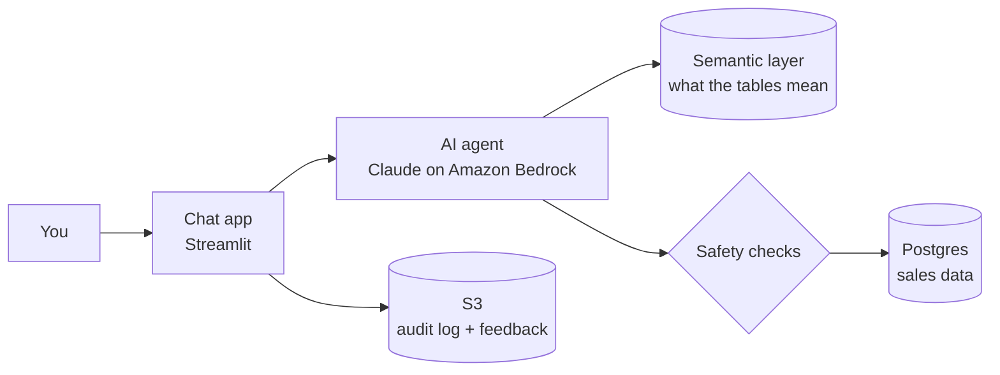

# Conversational Analytics Assistant

Ask questions about business data in plain English and get answers from a real database, with safeguards
that make the answers easier to trust.

> **Status:** a learning and portfolio project, not production-ready. See [Limitations](#limitations).

## What it does

You type a question such as *"Which employees have handled the most orders?"*. An AI assistant works out
which data it needs, queries the database, and replies with a short explanation and a results table. If your
question is vague (*"Show me the best customers"*), it asks what you mean instead of guessing.

The demo uses the public **Northwind** sample data: customers, orders, products, and employees of a small
trading company.

## How it works



1. You ask a question in the chat.
2. The agent decides what to do: ask you a clarifying question, look up what the tables mean, or write a SQL query.
3. Every query passes safety checks before it runs. If a query is rejected or fails, the agent sees the reason and tries again.
4. You get a plain-language answer and the result table. The answer, and every query it tried, is saved to a log, and you can rate it 👍 or 👎.

**Key terms**

- **Agent:** an AI that chooses its own next step (search, query, ask) instead of following a fixed script.
- **Semantic layer:** a file that describes the tables, columns and business terms, such as how *revenue* is calculated. See `semantic_layer/northwind_sales.json`.
- **Safety checks:** code that allows only read-only queries on documented tables and columns, with a row limit and a time limit.
- **Evaluation:** a set of test questions with known correct answers, used to check the assistant after every change.

## How it earns trust

- **It can only read.** Writes, deletes, and anything outside the documented tables and columns are blocked in code, not just in the prompt.
- **It asks instead of guessing,** and says so when the data cannot answer a question.
- **It is tested.** 31 test questions check answers, refusals, and that the data is never changed. The last run passed 31 of 31.
- **It is recorded.** Every answer is logged with the SQL used, and users can give feedback.

The reasoning behind these choices is in [design_breakdown.md](design_breakdown.md).

## Quick start

**You need:** Python 3.13, a Postgres database, and an AWS account with Amazon Bedrock access in `us-east-1`
(Claude Sonnet and Titan Text Embeddings v2 enabled) and an S3 bucket you can write to.

```bash
python -m venv .venv && source .venv/bin/activate
pip install -r requirements.txt
cp .env.example .env              # then fill in the values below
python scripts/load_northwind.py  # loads the sample data
streamlit run app.py
```

| Setting (in `.env`) | Required | What it is |
|---|---|---|
| `DATABASE_URL` | yes | Postgres connection string |
| `AWS_ACCESS_KEY_ID`, `AWS_SECRET_ACCESS_KEY` | yes | AWS credentials with Bedrock and S3 access |
| `AUDIT_BUCKET` | recommended | S3 bucket for the audit log and feedback. The default is the author's bucket, so set your own |

Two things to know before you run it:

- `load_northwind.py` **drops and recreates** 14 tables (`customers`, `orders`, and so on). Use a database dedicated to this project.
- The app also writes an older conversation log to the bucket named in `app.py` (`bucket_name`, near the top). Change it to your bucket, or the app fails when it tries to write that log.

## Try these questions

| Ask | What you should see |
|---|---|
| How many orders were shipped late? | A number (37) and a one-row table |
| Which employees have handled the most orders? | A ranked table with a short summary |
| Show me the best customers | A question back: best by what measure? |
| What is Nancy Davolio's home phone number? | A polite refusal; that data is out of scope |

## Tests and evaluation

```bash
python -m unittest discover -s tests -t .   # 29 unit tests (database tests are skipped without DATABASE_URL)
python -m evals.run_evals                   # asks the AI all 31 test questions; needs AWS and the database
```

The test questions are in `evals/golden_set.json`, and results are saved in `evals/results/`. The AI's answers
vary a little between runs, so treat a pass as a good sign, not a guarantee. Nothing runs these checks
automatically yet; you run them by hand.

## Deploying

The `Procfile` runs the app on Render. Set the same settings as environment variables there, and use the
database's **Internal** URL on Render (use the **External** URL on your own machine).

## Project structure

| Path | Purpose |
|---|---|
| `app.py` | The chat interface, answer logging, 👍/👎 buttons |
| `library.py` | The AI agent, its instructions, and its two tools (look up tables, run a query) |
| `db.py` | The only code that talks to the database, and where the safety checks live |
| `audit.py` | Saves answers and feedback to S3 |
| `semantic_layer/` | Descriptions of the tables, columns and business terms |
| `evals/` | Test questions and the script that runs them |
| `tests/` | Unit tests for the safety checks, audit log, and test grading |
| `data/`, `scripts/` | The Northwind sample data and the script that loads it |

## Limitations

- **No user logins or per-user permissions.** Everyone sees the same tables.
- **No monitoring yet.** The audit log has the data, but there is no dashboard or alerting.
- **Small test set.** 31 questions cannot cover everything users might ask.
- **Built around the Northwind data.** The agent's instructions and the test questions would need rewriting for another dataset.
- **Column checks go by name only,** not by which table a column belongs to, so they are looser than database-level permissions would be.

## Acknowledgements

Sample data: the Northwind database (originally a Microsoft sample), Postgres version from
[pthom/northwind_psql](https://github.com/pthom/northwind_psql).
